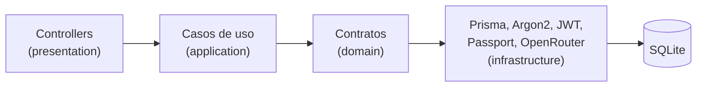

# Sintetiza API — NestJS + SOLID

Backend do **Sintetiza**: tarefas organizadas por espaços, importação de
conversas do WhatsApp, chat com IA que resume a conversa e **propõe tarefas
para confirmação**, preferências, lembrete diário e conta (e-mail/senha ou
convidado).

O ponto de partida foi um POC de autenticação com SOLID e Strategy Pattern; a
mesma arquitetura (contratos no domínio, detalhes na infraestrutura) foi
estendida a todos os módulos. O escopo funcional vem do protótipo em
`../prototipo` — o mapeamento tela → endpoint está em
[docs/modules.md](docs/modules.md).

---

## Stack

| Responsabilidade | Tecnologia |
| ---------------- | ---------- |
| Backend | NestJS 11, TypeScript 5 |
| Banco / ORM | SQLite, Prisma 6 (migrations versionadas) |
| Autenticação | Passport (local, JWT), argon2id, refresh token rotativo |
| IA | OpenRouter (DeepSeek) com streaming SSE e function calling |
| Jobs | @nestjs/schedule (somente limpeza de sessões/convidados; o lembrete é sob demanda) |
| Validação | class-validator + class-transformer |
| Documentação | OpenAPI 3 / Swagger UI em `/docs` |
| Testes | Jest + Supertest (unitários, integração com SQLite real, E2E) |

---

## Instalação do zero

Requisitos: **Node.js 20+** e npm.

```bash
npm install
cp .env.example .env          # Windows: copy .env.example .env

# gere um JWT_SECRET e cole no .env
node -e "console.log(require('crypto').randomBytes(48).toString('hex'))"

npm run db:migrate            # cria/atualiza prisma/dev.db (preserva dados existentes)
npm run db:seed               # demo@example.com / Demo@123
npm run start:dev
```

API em `http://localhost:3000`, documentação interativa em
`http://localhost:3000/docs`, disponibilidade em `GET /health`.

### Habilitando a IA (chat)

```env
OPENROUTER_API_KEY="sk-or-..."            # https://openrouter.ai/keys
OPENROUTER_MODEL="deepseek/deepseek-v4.1-flash"
```

Sem chave, tudo funciona exceto o chat, que responde `503` com a instrução.
O texto da conversa aberta, as últimas mensagens e a lista de tarefas são
enviados ao OpenRouter a cada pergunta.

Todas as variáveis estão comentadas em [`.env.example`](.env.example).

---

## Experimentando

```bash
# convidado (sem cadastro)
curl -X POST http://localhost:3000/auth/guest
TOKEN=<accessToken>

# criar tarefa com espaço novo
curl -X POST http://localhost:3000/tasks -H "Authorization: Bearer $TOKEN" \
  -H "Content-Type: application/json" \
  -d '{"title":"Enviar relatório","dueOn":"2026-10-14","priority":"high","spaceName":"Trabalho"}'

# tela Hoje
curl "http://localhost:3000/tasks?period=today&status=pending" -H "Authorization: Bearer $TOKEN"

# importar a conversa de exemplo e pedir as tarefas à IA (streaming)
curl -X POST http://localhost:3000/conversations/sample -H "Authorization: Bearer $TOKEN"
curl -N -X POST "http://localhost:3000/chat/messages?stream=true" \
  -H "Authorization: Bearer $TOKEN" -H "Content-Type: application/json" \
  -d '{"conversationId":"<id>","content":"Crie as tarefas desta conversa."}'
```

---

## Endpoints

| Método | Endpoint | Finalidade |
| ------ | -------- | ---------- |
| `POST` | `/auth/register` · `/auth/login` · `/auth/guest` | Cadastro, login, convidado (devolvem a sessão) |
| `POST` | `/auth/refresh` · `/auth/logout` | Renovar (refresh rotativo) e encerrar a sessão |
| `GET` | `/auth/me` | Identidade do token |
| `POST` | `/auth/password/forgot` · `/auth/password/reset` | Recuperação de senha (o link volta na resposta) |
| `GET` `PATCH` `DELETE` | `/account` | Perfil, editar, excluir conta |
| `GET` | `/account/activity` | Trilha de auditoria |
| `GET` `PATCH` | `/settings` | Tema, fuso, lembrete diário |
| `GET` `POST` | `/spaces` · `GET /spaces/suggestions` | Espaços com contadores |
| `GET` `PATCH` `DELETE` | `/spaces/:id` | Detalhar, renomear, excluir |
| `GET` `POST` | `/tasks` · `GET /tasks/summary` | Lista (período, status, espaço, busca, ordenação, paginação), criar, resumo |
| `GET` `PATCH` `DELETE` | `/tasks/:id` | Detalhes, editar, excluir |
| `POST` | `/tasks/:id/complete` · `/tasks/:id/reopen` | Concluir, reabrir |
| `GET` `POST` | `/conversations` · `POST /conversations/sample` | Histórico com busca, importar .txt, exemplo |
| `GET` `PATCH` `DELETE` | `/conversations/:id` · `GET /conversations/:id/content` | Detalhes, renomear, excluir, texto |
| `GET` | `/ai/status` · `/chat/messages` · `/chat/suggestions` | Estado da IA, histórico, sugestões |
| `POST` | `/chat/messages` · `/chat/retry` · `/chat/analysis` | Pergunta, tentar novamente, análise (JSON ou SSE) |
| `POST` | `/chat/proposals/:id/confirm` · `/discard` · `/chat/messages/:id/proposals/confirm-all` | Propostas de tarefas |
| `GET` `POST` | `/notifications` · `/:id/read` · `/read-all` | Avisos não lidos (polling; gera o lembrete vencido), marcar lida |
| `GET` | `/health` · `/docs` | Disponibilidade, Swagger |

Contrato completo: [`docs/swagger/api.swagger.yaml`](docs/swagger/api.swagger.yaml).

---

## Arquitetura em uma imagem



O núcleo nunca importa Prisma, Argon2, JWT ou o cliente HTTP da IA. A escolha
do provedor de login continua sem `if/else`: e-mail e convidado são
Strategies registradas em um array. Detalhes em
[`docs/architecture.md`](docs/architecture.md) e [`docs/solid.md`](docs/solid.md).

---

## Scripts

```bash
npm run start:dev        # desenvolvimento com watch
npm run build            # compila para dist/
npm run start:prod       # roda o build

npm run lint             # ESLint com --fix
npm run lint:check       # ESLint sem alterar arquivos
npm run format           # Prettier

npm test                 # unitários + integração
npm run test:unit
npm run test:integration
npm run test:e2e
npm run test:cov         # os três, com cobertura
npm run docs:lint        # valida o OpenAPI

npm run db:migrate       # migration em desenvolvimento
npm run db:deploy        # aplica migrations pendentes (produção/CI)
npm run db:seed          # usuário de desenvolvimento
npm run db:studio        # Prisma Studio
npm run db:reset         # recria o banco do zero (apaga dados)
```

---

## Documentação

| Documento | Conteúdo |
| --------- | -------- |
| [docs/modules.md](docs/modules.md) | Módulos, regras de negócio, protótipo → endpoint, integração com o app |
| [docs/architecture.md](docs/architecture.md) | Camadas, dependências, erros, autorização, decisões |
| [docs/solid.md](docs/solid.md) | Cada princípio apontando para arquivos reais |
| [docs/authentication-flow.md](docs/authentication-flow.md) | Cadastro, login, convidado, sessões, refresh, logout, recuperação |
| [docs/database.md](docs/database.md) | Modelo, relacionamentos, índices, migrations, transações |
| [docs/testing.md](docs/testing.md) | Pirâmide, fakes, cobertura, casos cobertos |

---

## Pendências e limites conhecidos

| Item | Situação |
| ---- | -------- |
| Envio de e-mail na recuperação de senha | Não há envio de e-mail: `POST /auth/password/forgot` devolve o link e os dados na própria resposta, em qualquer ambiente. |
| Push com o app fechado | O lembrete é gerado quando o app consulta `GET /notifications`; push (Expo/FCM/APNs) exige registrar tokens de dispositivo. |
| Integração do app mobile | O app `Sintetiza/` ainda usa dados simulados; o passo a passo está em [docs/modules.md](docs/modules.md#integração-com-o-app-mobile-sintetiza). |
| Busca textual em escala | Filtros estruturados rodam no banco; a busca sem acentos roda em memória por usuário. Para volumes grandes: PostgreSQL com `unaccent` + índice trigram ou FTS. |
| Converter convidado em conta | Como no protótipo, criar conta a partir do convidado começa um perfil novo; migrar os dados seria uma extensão. |
| Rate limiting | Não há limite de requisições por IP/usuário (relevante para login e chat). |

---

## Licença

MIT.
