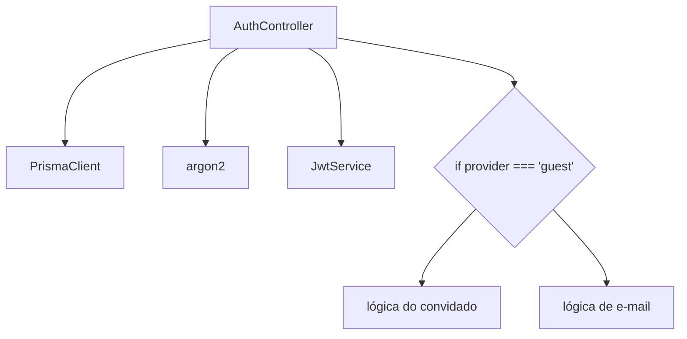
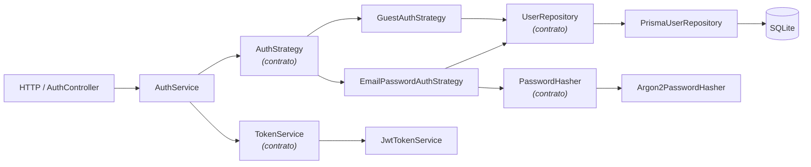
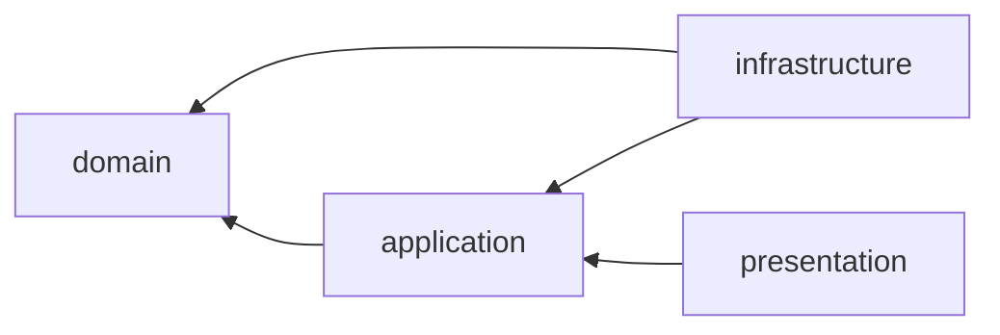
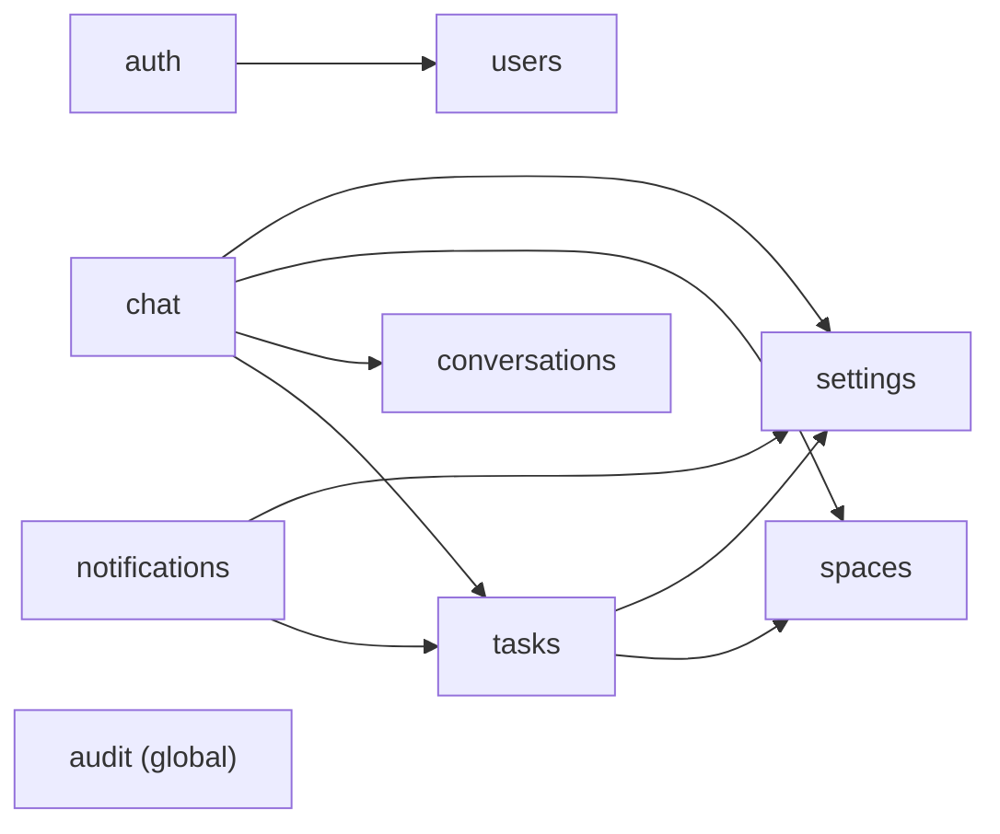

# Arquitetura

> O POC de autenticação evoluiu para o backend completo do Sintetiza. As seções
> sobre Strategies e Passport continuam válidas; os demais módulos repetem as
> mesmas camadas. Regras de negócio e endpoints: [modules.md](modules.md).

## Objetivo

Autenticar usuários por mais de um mecanismo, mantendo cada mecanismo isolado,
substituível e testável sem banco, sem rede e sem framework.

O critério de sucesso não é "o login funciona" — isso um controller de 30 linhas
resolve. O critério é: **adicionar o segundo provedor não deve exigir alterar o
primeiro**.

## O que estamos evitando

A versão ingênua concentra tudo na borda:



Três problemas: o controller sabe demais; cada novo provedor engorda o `if`; e
não há como testar a regra sem subir HTTP e banco.

## O desenho adotado



O núcleo conhece apenas contratos:

```
AuthStrategy · UserRepository · PasswordHasher · TokenService
```

E nunca conhece os detalhes:

```
PrismaClient · argon2 · JwtService · Passport · SQLite
```

## Camadas

O material da aula usa `Presentation / Domain / Data`. Aqui usamos quatro
nomes, o que **não** é uma mudança de princípio — é só a divisão natural de um
backend:

| Camada | Papel | Pode depender de |
| ------ | ----- | ---------------- |
| `presentation/` | Traduz HTTP em chamadas de caso de uso | `application`, `domain` |
| `application/` | Casos de uso e regras de autenticação | `domain` |
| `domain/` | Entidades e contratos. Sem dependências. | nada |
| `infrastructure/` | Detalhes concretos: Prisma, Argon2, JWT, Passport | `domain`, `application` |

`infrastructure` corresponde ao que o material chama de borda/`Data`. A camada
`application` só deixa os casos de uso explícitos.

**A regra que sustenta tudo:** as setas de dependência apontam para dentro.
Detalhes conhecem contratos; contratos não conhecem detalhes.



## Estrutura de pastas

Cada módulo de negócio repete as mesmas quatro camadas; o módulo `auth` é o
exemplo mais completo.

```
src/
├── main.ts                        bootstrap (CORS, pipes, filtro, Swagger)
├── bootstrap.ts                   configuração HTTP comum ao main.ts e aos testes E2E
├── app.module.ts                  módulos + middleware de request-id
├── swagger.ts                     serve o api.swagger.yaml em /docs
├── config/                        configuração tipada (app, auth, ai, database) + validação de env
├── database/                      PrismaService, TransactionManager (AsyncLocalStorage), erros do Prisma
├── health/                        GET /health
├── shared/
│   ├── domain/                    datas de calendário/fuso, busca sem acentos, Clock
│   ├── errors/                    erros de aplicação + filtro HTTP único
│   ├── http/                      request-id/log de acesso, validação (pipe, decorators)
│   └── pagination.ts              DTO e envelope { data, meta }
│
└── modules/
    ├── auth/                      cadastro, login, convidado, sessões, recuperação, manutenção
    │   ├── domain/                contratos: AuthStrategy, TokenService, SessionRepository,
    │   │                          SecureTokenGenerator, PasswordReset*, PasswordHasher
    │   ├── application/           AuthService, SessionService, RegistrationService,
    │   │                          PasswordResetService, AuthMaintenanceService, strategies/
    │   ├── presentation/          AuthController, DTOs, @CurrentUser
    │   └── infrastructure/        auth.module, passport/, guards/, security/, persistence/,
    │                              notifications/, jobs/
    ├── users/                     User, UserRepository, AccountService, AccountController
    ├── settings/                  preferências, "hoje" do usuário
    ├── spaces/                    espaços e contadores
    ├── tasks/                     regras de campos, ordenação, períodos, TasksService
    ├── conversations/             parser do WhatsApp, estatísticas, importação
    ├── chat/                      prompt e validação das propostas (domínio), ChatService,
    │                              ProposalsService, OpenRouterProvider, SSE
    ├── notifications/             notificações (polling) e lembrete diário sob demanda
    └── audit/                     AuditService (global) e GET /account/activity
```

Dependências entre módulos (sempre por serviços exportados, nunca por
repositórios de outro módulo):



## O papel do Passport

Existem **duas** coisas chamadas "strategy" neste projeto, e confundi-las
desmonta o exercício inteiro:

| | `AuthStrategy` (domínio) | `PassportStrategy` (infraestrutura) |
| - | ------------------------ | ----------------------------------- |
| Onde | `application/strategies/` | `infrastructure/passport/` |
| Responde | "quem é este usuário?" | "como extrair credenciais da request?" |
| Exemplos | `EmailPasswordAuthStrategy`, `GuestAuthStrategy` | `LocalPassportStrategy`, `JwtPassportStrategy` |
| Testável | com fakes, sem framework | precisa do Passport |

O Passport é um **adaptador**. `LocalPassportStrategy` não decide nada: extrai
`email` e `password` da requisição e chama `AuthService`. Se o Passport fosse
removido amanhã, as regras continuariam existindo.

## O papel do Prisma

`PrismaUserRepository` é o único arquivo do módulo de usuários que importa
`@prisma/client`. Seu método privado `toDomain()` é a fronteira: dali para
dentro, o sistema só conhece a entidade `User` do domínio.

Isso não é cerimônia. Se o resto do código usasse o tipo gerado pelo Prisma,
toda regra de negócio passaria a depender do ORM.

## Como o provedor é escolhido sem `if/else`

Esta é a pergunta central do exercício. A resposta está em
[`auth.module.ts`](../src/modules/auth/infrastructure/auth.module.ts):

```ts
const authStrategiesProvider: Provider = {
  provide: AUTH_STRATEGIES,
  useFactory: (email, guest) => [email, guest],
  inject: [EmailPasswordAuthStrategy, GuestAuthStrategy],
};
```

O `AuthService` recebe esse array e monta um `Map<AuthProvider, AuthStrategy>`
no construtor. Escolher a Strategy vira uma consulta:

```ts
const strategy = this.registry.get(provider);
```

Registrar um novo provedor amanhã = criar uma classe e acrescentar uma
linha ao array. `AuthService`, `AuthController` e as Strategies existentes não
mudam.

## Tratamento de erros

O núcleo lança erros de aplicação, que não sabem o que é HTTP.
`ApplicationErrorFilter` é o único ponto que traduz — inclusive os erros do
próprio Nest (validação de DTO, rota inexistente) e erros inesperados (que
viram `500` genérico, com a pilha só no log):

| Erro do núcleo | HTTP |
| -------------- | ---- |
| `ValidationError`, `UnsupportedAuthProviderError` | 400 |
| `InvalidCredentialsError`, `SessionExpiredError` | 401 |
| `ForbiddenError` | 403 |
| `NotFoundError` | 404 |
| `ConflictError` | 409 |
| `PayloadTooLargeError` | 413 |
| `UpstreamServiceError` | 502 |
| `ServiceUnavailableError` | 503 |
| qualquer outro | 500 |

Formato único:

```json
{
  "statusCode": 409,
  "error": "ConflictError",
  "message": "Ja existe um espaco com esse nome.",
  "field": "name",
  "path": "/spaces",
  "timestamp": "2026-10-14T12:00:00.000Z",
  "requestId": "7c1f6a8e-..."
}
```

Erros de DTO trazem `error: "ValidationError"`, `details` (todas as mensagens)
e `field` (o primeiro campo inválido, inclusive aninhado:
`dailyReminder.time`). No streaming do chat, um erro depois do início vira o
evento SSE `error` com o mesmo corpo.

## Autorização

Toda rota de recurso usa `JwtAuthGuard`. Os serviços sempre consultam com o
`userId` do token; recurso de outro usuário responde `404` (não `403`), para
não revelar que existe. Convidados têm as mesmas permissões sobre os próprios
dados, exceto editar o perfil.

## Decisões conscientes

| Decisão | Motivo |
| ------- | ------ |
| Sessão no banco + refresh rotativo | "Sair" e trocar a senha precisam invalidar tokens; ver [authentication-flow.md](authentication-flow.md). |
| `passwordHash`, `email` e `username` opcionais | Convidado não tem senha, e-mail nem username. |
| Transação por `AsyncLocalStorage` | Casos de uso declaram atomicidade sem conhecer o Prisma; repositórios participam sem parâmetro extra. |
| Contexto da IA montado no servidor | O protótipo enviava conversa e tarefas do navegador; aqui o servidor lê do banco, valida e nunca expõe a chave. |
| Provedor de IA atrás de `AiProvider` | Os testes usam um roteiro determinístico; trocar de modelo/endpoint não toca no chat. |
| Busca de texto em memória (por usuário) | SQLite não ignora acentos; filtros estruturados (status, período, espaço) vão ao banco e só a busca textual roda na aplicação. Para volumes grandes, ver pendências no README. |
| Lembrete sob demanda, sem job | O app já consulta `GET /notifications` periodicamente; a consulta gera o lembrete vencido com reserva atômica do dia. Só a limpeza de autenticação usa job (`JOBS_ENABLED`). |
| Swagger em arquivo único | Ver [README.md](README.md). |
| SQLite | Zero configuração; os repositórios escondem a escolha. |
