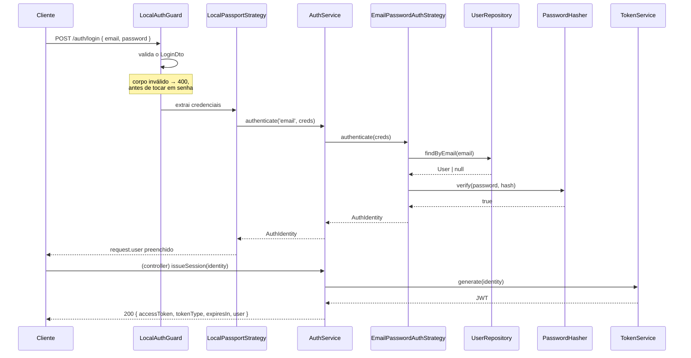
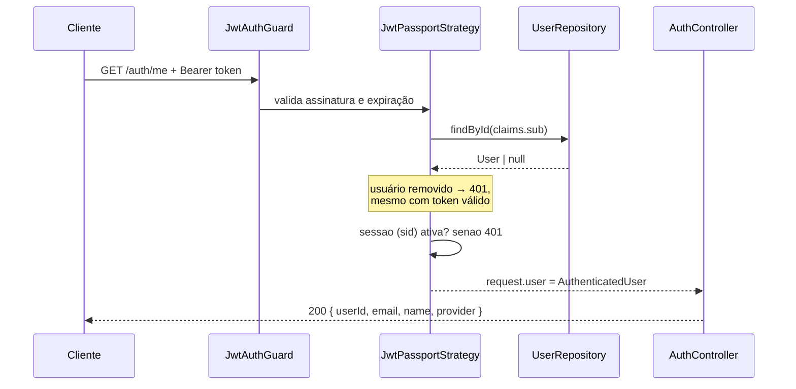
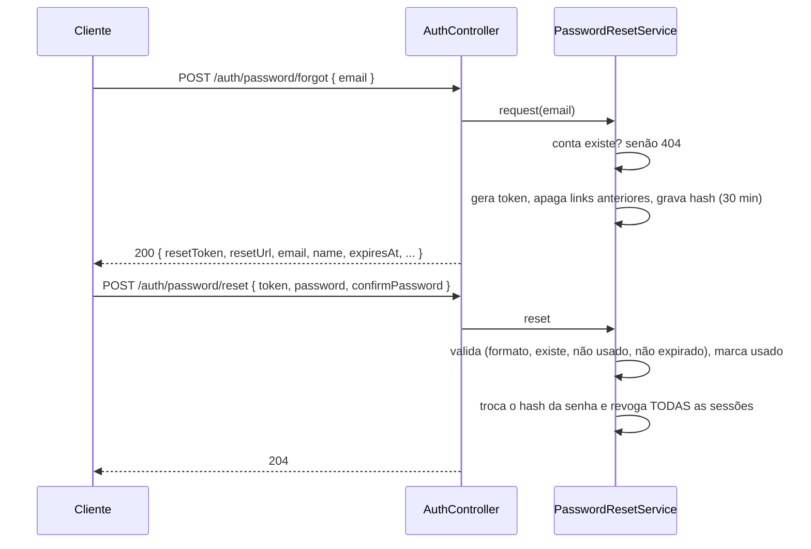

# Fluxos de autenticação

## Login por e-mail e senha



### Por que o guard valida o DTO

No NestJS, **guards rodam antes dos pipes**. Sem a validação dentro de
[`LocalAuthGuard`](../src/modules/auth/infrastructure/guards/local-auth.guard.ts),
um corpo malformado seria rejeitado pelo Passport como `401`, quando o correto
é `400`: o cliente errou a requisição, não a senha.

| Situação | Status |
| -------- | ------ |
| corpo ausente, e-mail inválido, senha curta, campo desconhecido | `400` |
| e-mail não cadastrado | `401` |
| senha incorreta | `401` |
| usuário existe mas não tem senha local | `401` |

### Por que a mensagem de erro é sempre a mesma

`InvalidCredentialsError` é lançado com o mesmo texto para "usuário não existe"
e "senha errada". Mensagens diferentes permitiriam descobrir quais e-mails
estão cadastrados, um por um.

> **Limite conhecido.** A resposta é idêntica, mas o *tempo* de resposta não:
> quando o usuário existe, o Argon2 roda; quando não existe, retornamos antes.
> Um atacante paciente consegue medir isso. Mitigar exigiria verificar um hash
> descartável no caminho de "usuário inexistente". Ficou de fora do escopo, mas
> a limitação é real e está registrada aqui.

---

## Rota protegida — `GET /auth/me`



A consulta ao repositório é deliberada. Um JWT continua criptograficamente
válido depois que o usuário some do banco; sem essa checagem, o token ainda
abriria a rota.

---

## Cadastro — `POST /auth/register`

Regras herdadas da tela de cadastro do protótipo:

| Campo | Regra |
| ----- | ----- |
| `username` | 3 a 30 caracteres `a-z 0-9 . _`, normalizado para minúsculas, único |
| `email` | válido, normalizado (aparado, minúsculas), único |
| `password` | 8 a 128 caracteres |
| `confirmPassword` | igual a `password` |
| `name` | opcional; padrão = `username` |

Duplicidade responde `409` com `field` (`username` ou `email`). A checagem
prévia dá a mensagem certa; a constraint única do banco é a garantia final
contra corridas e o repositório a traduz no mesmo `ConflictError`. O cadastro
já devolve a sessão (o app entra direto em "Hoje").

---

## Convidado — `POST /auth/guest`

"Continue como convidado" virou a **terceira Strategy** (`GuestAuthStrategy`):
uma classe nova e uma linha no registro de `auth.module.ts`, sem tocar em
`AuthService`, `AuthController` ou nas outras Strategies — o mesmo critério de
Open/Closed do exercício original.

Cada convidado ganha um usuário próprio (`isGuest = true`, sem e-mail e sem
senha), com dados isolados como os de qualquer conta. Convidados **sem sessão
ativa** há mais de `GUEST_RETENTION_DAYS` (30) são removidos pela manutenção
agendada, junto com todos os dados. Convidados não editam o perfil (`403`).

---

## Sessões e tokens

```mermaid
sequenceDiagram
    participant C as Cliente
    participant API as AuthController
    participant SS as SessionService
    participant DB as sessions

    C->>API: login / register / guest
    API->>SS: start(identity)
    SS->>DB: cria sessão (hash do refresh token, validade 30 dias)
    SS-->>C: accessToken (JWT com sid) + refreshToken (opaco)
    Note over C: access expira (JWT_EXPIRES_IN)
    C->>API: POST /auth/refresh { refreshToken }
    API->>SS: refresh
    SS->>DB: troca o hash SE ainda for o atual (rotação)
    SS-->>C: novo par; o refresh antigo deixa de valer
```

Payload do JWT:

```json
{ "sub": "clx...", "email": "demo@example.com", "provider": "email", "sid": "cly...", "iat": 1767225600, "exp": 1767229200 }
```

- **Access token**: JWT curto (`JWT_EXPIRES_IN`, padrão 1h). O claim `sid`
  aponta para a sessão; o guard confere a cada requisição que a sessão existe,
  pertence ao usuário, não foi revogada e não expirou.
- **Refresh token**: 32 bytes aleatórios (64 hex), opaco. O banco guarda só o
  SHA-256. Cada uso gera um novo e invalida o anterior (rotação condicional:
  duas requisições com o mesmo token não renovam duas vezes).
- A tradução `sub`/`sid` ↔ `subject`/`sessionId` fica confinada em
  [`JwtTokenService`](../src/modules/auth/infrastructure/security/jwt-token.service.ts).

---

## Logout

```
POST /auth/logout  →  204 No Content
```

Revoga **a sessão do token**: o access token e o refresh token daquela sessão
deixam de valer imediatamente; outras sessões (outros aparelhos) continuam.
Os testes E2E `o token deixa de valer depois do logout` e `o logout encerra so
a sessao do token` documentam o comportamento.

> Esta era a limitação consciente do POC original (JWT stateless, sem
> revogação). Com o app real — "Sair" precisa sair, e trocar a senha precisa
> derrubar as sessões — a sessão passou a existir no banco. O custo é uma
> consulta por requisição autenticada (por chave primária).

---

## Recuperação de senha



- Uso único, validade `PASSWORD_RESET_TTL_MINUTES` (30); gerar outro link
  invalida o anterior.
- **Entrega**: não há envio de e-mail no projeto (o protótipo também não
  enviava). O link de redefinição e os dados da solicitação voltam **sempre**
  na própria resposta de `POST /auth/password/forgot`, em qualquer ambiente:
  é a única forma de entrega. `resetUrl` é `PASSWORD_RESET_URL` + token.
- Como o link vai na resposta, não há o que esconder: e-mail sem conta
  responde `404` (o login continua com a mensagem única de credenciais).
- Uma conta sem senha local pode usar o fluxo para definir uma.

---

## Manutenção agendada

`AuthMaintenanceJob` roda de hora em hora (e na subida), se `JOBS_ENABLED`:

| Limpeza | Critério |
| ------- | -------- |
| Sessões | expiradas ou revogadas há mais de 7 dias |
| Links de redefinição | expirados ou já usados |
| Convidados | sem sessão ativa e criados há mais de `GUEST_RETENTION_DAYS` |
