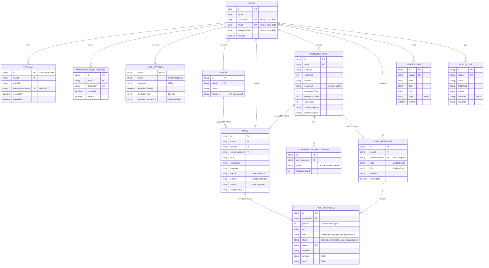

# Banco de dados

## Escolha

SQLite via Prisma: zero configuração, o banco é um arquivo. Do ponto de vista
do resto do sistema a escolha é invisível — só os repositórios em
`*/infrastructure/` conhecem o Prisma. Trocar por PostgreSQL muda o `provider`
do schema e gera uma nova migration; nenhuma regra de negócio muda.

A fonte da verdade é [`prisma/schema.prisma`](../prisma/schema.prisma).

## Modelo



Todas as tabelas têm `createdAt` (e `updatedAt` onde há edição).

## Decisões

| Decisão | Motivo |
| ------- | ------ |
| Todo dado tem `userId` e `ON DELETE CASCADE` | Excluir a conta remove tudo (sessões, preferências, espaços, tarefas, conversas, chat, notificações, auditoria). O isolamento entre usuários é aplicado em toda consulta (`where userId`). |
| Excluir espaço → tarefas `spaceId = NULL` | Regra do protótipo: as tarefas continuam salvas, "Sem espaço". O repositório desvincula explicitamente (atualiza `updatedAt`) e a FK garante o mesmo em qualquer caminho. |
| Excluir conversa → mensagens em cascata, tarefas `conversationId = NULL` | Regra do protótipo: o histórico some, as tarefas ficam. |
| Excluir tarefa → propostas `taskId = NULL` + `taskTitle` | O cartão da proposta continua legível no histórico depois da exclusão. |
| Exclusão física (sem *soft delete*) | O protótipo trata exclusões como definitivas ("Esta ação é definitiva") e a conta inteira pode ser apagada. A rastreabilidade fica na trilha de auditoria. |
| Datas de calendário como `TEXT` `AAAA-MM-DD` | Prazo e conclusão são datas "de parede" do usuário, sem fuso. A ordem léxica coincide com a cronológica, o que permite `BETWEEN` e índices. |
| Enums como `TEXT` validado no domínio | SQLite não tem enum; os valores aceitos estão no domínio (`task.ts`, `chat.ts`, `settings.ts`) e documentados no schema. |
| `spaces.nameKey` | Nome sem acentos, minúsculo e com espaços colapsados; `UNIQUE(userId, nameKey)` impede "Trabalho" e "trabálho " no mesmo perfil, inclusive em corrida. |
| `conversations.fingerprint` | SHA-256 do texto com quebras normalizadas; `UNIQUE(userId, fingerprint)` faz reimportar abrir a conversa existente. |
| Estatísticas da conversa materializadas | O texto é imutável depois da importação; calcular participantes e período uma vez evita reprocessar até 10 MB a cada abertura dos detalhes. |
| Tokens só como hash | `sessions.refreshTokenHash` e `password_reset_tokens.tokenHash` guardam SHA-256: um vazamento do banco não permite usar nenhum token. |
| `user_settings` 1:1 com padrões | Sem linha, a API devolve os padrões (`system`, `America/Sao_Paulo`, lembrete desligado às 09:00). |
| `reminderLastSentOn` com atualização condicional | `UPDATE ... WHERE reminderLastSentOn <> hoje` garante no máximo um lembrete por dia, mesmo com várias instâncias da API. |
| JSON em `TEXT` (`payload`, `result`, `metadata`, `data`) | Estruturas variáveis por tipo e sempre lidas inteiras; o repositório serializa e valida na fronteira. |

## Índices

| Tabela | Índice | Consulta atendida |
| ------ | ------ | ----------------- |
| `tasks` | `(userId, status)`, `(userId, dueOn)`, `(userId, spaceId)`, `(userId, createdAt)`, `(conversationId)` | listas por situação, períodos (Hoje/Amanhã/Semana), por espaço, ordenação e desvínculo |
| `spaces` | `UNIQUE(userId, nameKey)`, `(userId, createdAt)` | unicidade e listagem |
| `conversations` | `UNIQUE(userId, fingerprint)`, `(userId, createdAt)` | deduplicação e histórico |
| `chat_messages` | `(userId, conversationId, createdAt)` | fio da conversa |
| `task_proposals` | `UNIQUE(messageId, position)`, `(status, ref)`, `(taskId)` | substituição por `ref` e desvínculo |
| `sessions` | `UNIQUE(refreshTokenHash)`, `(userId)`, `(expiresAt)` | refresh, revogação em massa, limpeza |
| `password_reset_tokens` | `UNIQUE(tokenHash)`, `(userId)`, `(expiresAt)` | validação e limpeza |
| `notifications` | `(userId, readAt)`, `(userId, createdAt)` | não lidas e listagem |
| `audit_logs` | `(userId, createdAt)`, `(action)` | atividade do usuário |
| `users` | `(isGuest, createdAt)` | limpeza de convidados |

## Migrations

| Migration | Conteúdo |
| --------- | -------- |
| `20260907214723_init_user` | Tabela `users` do POC original |
| `20261111180000_sintetiza_domain` | Todas as tabelas do domínio; `users` ganha `username`, `isGuest` e `email` opcional (a tabela é redefinida **preservando os dados existentes**) |

```bash
npm run db:migrate   # desenvolvimento: aplica e gera o client
npm run db:deploy    # produção/CI: aplica as pendentes
npm run db:reset     # recria do zero (apaga os dados)
```

Os testes de integração e E2E criam `prisma/test.db` aplicando **as mesmas
migrations** (`prisma migrate deploy`), então uma migration quebrada falha a
suíte.

## Seed

`npm run db:seed` cria (ou atualiza) o usuário de desenvolvimento
`demo@example.com` / `Demo@123` (username `demo`) com o espaço "Trabalho" e uma
tarefa de boas-vindas. Variáveis `SEED_USER_*` no `.env`.

## Transações

Casos de uso que tocam mais de uma tabela rodam em uma unidade de trabalho
(`TransactionManager.run`). A implementação Prisma usa `AsyncLocalStorage`:
qualquer repositório chamado dentro de `run` obtém o client da transação por
`dbClient()`, sem receber parâmetro extra. Transações aninhadas reutilizam a
externa. Exemplos: confirmar uma proposta (cria espaço + tarefa + resolve a
proposta), redefinir a senha (troca o hash + marca o link + revoga sessões),
gerar o lembrete (reserva o dia + cria a notificação).

Os testes de integração verificam que uma falha no meio desfaz tudo.
