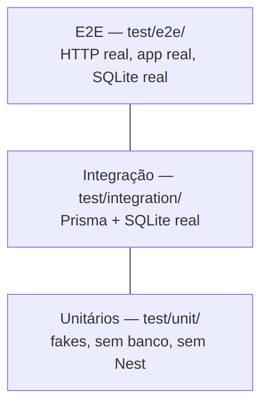

# Testes

## Pirâmide



| Nível | O que valida | O que é real | O que é fake |
| ----- | ------------ | ------------ | ------------ |
| Unitário | regras de domínio e casos de uso | a classe sob teste | repositórios, hasher, tokens, relógio, IA |
| Integração | schema, constraints, mapeamento | Prisma + SQLite | nada |
| E2E | contrato HTTP completo | tudo, inclusive migrations | só o modelo de linguagem (roteiro) |

## Comandos

```bash
npm run test:unit          # rápido, roda a cada salvamento
npm run test:integration   # exige o banco de teste
npm run test:e2e           # sobe a aplicação inteira
npm test                   # unitários + integração
npm run test:cov           # os três, com cobertura
npm run test:watch         # unitários em watch mode
```

## O que é mockado e o que não é

**Mockado nos testes unitários** — [`test/helpers/fakes.ts`](../test/helpers/fakes.ts):

- `InMemoryUserRepository` implementa `UserRepository` com um `Map`
- `FakePasswordHasher` usa `hashed:<senha>`, previsível e instantâneo
- `FakeTokenService` devolve `token-for:<userId>` e registra as chamadas
- `InMemorySessionRepository`, `InMemoryPasswordResetRepository`, `InMemoryAuditRepository`,
  `FakeSecureTokenGenerator`, `FixedClock` e `ImmediateTransactionManager`
- `buildSessionKit()` monta um `SessionService` completo sobre esses fakes

Esses fakes são implementações honestas dos contratos, não `jest.mock()` sobre
módulos. É o Dependency Inversion pagando dividendo: as regras podem rodar sem
banco porque nunca dependeram de banco.

**Nunca mockado:**

- **Prisma nos testes de integração.** Mockar o ORM ali seria testar o mock. O
  valor do nível está justamente em verificar que a constraint `@unique`
  funciona e que `toDomain()` mapeia certo.
- **Argon2.** [`argon2-password-hasher.spec.ts`](../test/unit/argon2-password-hasher.spec.ts)
  usa o algoritmo real. É lento de propósito — é o que um hash de senha deve
  ser — daí o timeout estendido nessa suíte.
- **Nada no E2E.** A aplicação sobe com os mesmos pipes e filtros do
  `main.ts`.

**A única fronteira substituída:** o modelo de linguagem. O
`OpenRouterProvider` é testado com um `fetch` injetado que devolve streams SSE
reais; os E2E usam o `ScriptedAiProvider`.

## Banco de teste

Desenvolvimento e teste usam arquivos diferentes:

```env
# .env        →  DATABASE_URL="file:./dev.db"
# .env.test   →  DATABASE_URL="file:./test.db"
```

[`test/setup/global-setup.ts`](../test/setup/global-setup.ts) roda uma vez, antes
das suítes de integração e E2E:

```
apaga prisma/test.db
        ↓
prisma migrate deploy  (aplica as migrations versionadas num arquivo novo)
        ↓
cada suíte limpa a tabela no beforeEach / cria seu próprio fixture
        ↓
testes
```

Banco novo a cada execução é o que torna os testes determinísticos: eles não
herdam nada da rodada anterior nem do banco de desenvolvimento.

Integração e E2E rodam com `maxWorkers: 1`. SQLite é um arquivo único, e suítes
paralelas se atropelariam.

> Por que `migrate deploy` e não `db push`: o banco de teste nasce das
> **mesmas migrations** de desenvolvimento e produção, então uma migration
> quebrada ou divergente do schema falha a suíte.
>
> E por que o arquivo é apagado antes: assim a operação é sempre uma criação,
> nunca um reset destrutivo. O banco de desenvolvimento não corre risco.

## Cobertura

Configurada em [`jest.config.js`](../jest.config.js):

| Escopo | Linhas | Statements | Branches | Funções |
| ------ | ------ | ---------- | -------- | ------- |
| Projeto | 90% | 90% | 85% | 90% |
| `modules/auth/application/` | 100% | 100% | 100% | 100% |

O núcleo tem exigência maior porque é onde moram as regras. `main.ts`,
`swagger.ts` e os `*.module.ts` ficam fora da conta: são fiação, e testá-los
mediria configuração, não comportamento.

> **Sobre a meta.** 100% em todo o projeto incentivaria testes escritos para
> mover o número, não para verificar comportamento. Mais importante que a
> porcentagem é ter, para cada componente, os caminhos de **sucesso**,
> **entrada inválida**, **credencial inválida**, **dependência falhando** e
> **não autenticado**.

Relatório em HTML após `npm run test:cov`:

```
coverage/lcov-report/index.html
```

## Casos cobertos

Resultado da última execução (`npm run test:cov`): **24 suítes, 316 testes,
todos passando**; cobertura global ≈ 98% de linhas e 87% de branches;
`modules/auth/application/` em 100%.

### Unitários (`test/unit/`)

| Suíte | Cobre |
| ----- | ----- |
| `email-password-auth`, `passport-adapters` | Strategies e adaptadores do Passport; JWT rejeitado para usuário removido, sessão encerrada, `sid` ausente ou de outro usuário |
| `auth.service`, `auth.controller` | registro de Strategies (email, guest), emissão de sessão, todas as rotas de auth sem HTTP |
| `auth-application` | `SessionService` (rotação, reuso, expiração, revogação, limpeza), `RegistrationService`, `GuestAuthStrategy`, `PasswordResetService` (link devolvido com os dados, 404 para e-mail sem conta, uso único, expiração, substituição, corrida, conta removida), `AuthMaintenanceService` |
| `account-and-dtos` | `AccountService` (conflitos, convidado, exclusão), `AuditService` (falha não derruba), validação de todos os DTOs e o `field` do pipe global |
| `domain-rules` | datas e fusos, períodos (semana seg–dom), busca sem acentos, paginação, parser do WhatsApp (Android/iOS/BOM/continuações/datas US), estatísticas, regras de espaço e de tarefa, ordenações |
| `assistant-prompt` | montagem do prompt (conversa como dado, truncamento, tarefas, espaços, data), validação das propostas da IA, descrição do histórico, sugestões |
| `openrouter.provider` | streaming SSE fragmentado, chamadas de função, erros 401/402/429/5xx, conexão recusada/caída, chunk inválido, cancelamento |
| `jobs-and-chat` | job de manutenção só com `JOBS_ENABLED`, sem sobreposição e resistente a falhas; lembrete diário sob demanda (horário no fuso, um por dia, fuso inválido); resposta interrompida salva com o trecho recebido |
| `application-error.filter`, `config`, `env.validation`, `jwt-token.service`, `argon2-password-hasher`, `login.dto` | mapeamento de todos os erros, configuração e infraestrutura |

### Integração (`test/integration/`, SQLite criado pelas migrations)

Transação desfeita por inteiro em falha e transação aninhada · unicidade
(username, e-mail, nome de espaço, impressão digital da conversa) traduzida em
`ConflictError` · cascata ao excluir o usuário (8 tabelas) · `SET NULL` ao
excluir espaço, conversa e tarefa · limpeza de convidados · contagens por
espaço/status · escopo de prazo · substituição de propostas por `ref` no mesmo
fio · resolução condicional · rotação condicional do refresh token · link de
uso único · reserva atômica do lembrete (duas chamadas simultâneas, uma vence)
· notificações · auditoria.

### E2E (`test/e2e/`, aplicação inteira via HTTP)

| Suíte | Fluxos |
| ----- | ------ |
| `auth` | login, `/auth/me`, logout revogando só a sessão do token, refresh com rotação e reuso negado |
| `account-settings` | cadastro (normalização, validações, 409 com `field`), convidado (perfil 403, limpeza), recuperação de senha completa (sessões encerradas, uso único, link substituído, link e dados na resposta, 404 para e-mail sem conta), editar/excluir conta com cascata, atividade com `X-Request-Id`, configurações, notificações por polling (lembrete gerado na consulta, sem duplicar em consultas simultâneas; lida some da lista; read-all; 404 de outro usuário), `/health`, formato de erro |
| `tasks-spaces` | isolamento entre usuários (404), CRUD, `spaceName`, validações, Hoje/Amanhã/Semana/Todas com contadores, busca, ordenações, paginação, resumo e atrasadas, espaços com "Sem espaço", busca, atalhos, renomear/excluir |
| `conversations-chat` | importação (formatos, duplicada 200, .pdf/vazio/inválido 400, >10 MB 413), exemplo, histórico com busca por conteúdo, renomear, texto, excluir; chat JSON e SSE, IA não configurada 503, falha do provedor 502/evento `error`, tentar novamente, análise, sugestões; propostas criar/editar/concluir/reabrir/excluir, confirmar com edição, descartar, 409 em proposta resolvida, substituição por `ref`, confirmar todas, conversa excluída mantém tarefas |

O modelo de linguagem é a **única** dependência substituída nos E2E: o
`ScriptedAiProvider` (em `test/helpers/`) devolve respostas roteirizadas e
registra as requisições, o que permite verificar o prompt montado pelo
servidor. Nenhum teste chama o OpenRouter.

## Definition of done

```bash
npm run lint:check
npm test
npm run test:e2e
npm run test:cov
npm run docs:lint
```
